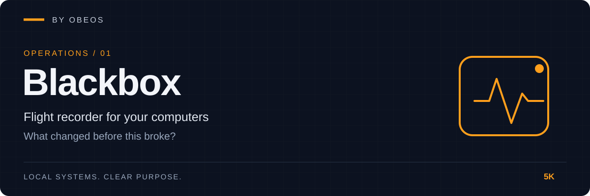

<div align="center">



**Flight recorder for your computers. When something breaks, find out what changed before it did.**

[](https://github.com/5K-bit/blackbox/actions/workflows/ci.yml)


[](LICENSE)

</div>

[Quick start](#quick-start) · [Demonstration](#demonstration) · [Tests](#tests-and-evidence) · [Limitations](#limitations)

---

## Overview

Blackbox is a local recorder for one machine. While it runs, it keeps a searchable timeline of **configuration changes, service failures and resource spikes**. When something breaks, `blackbox incident` turns that timeline into a report: what failed, what happened before it, how long before, and the exact diff of every configuration file that changed.

It answers one question: **what changed before this broke?**

Part of the OBEOS projects, and it works completely on its own. No server, no account, no network access beyond the TCP probes you configure, and nothing leaves the machine. The core has no third-party dependencies.

> **Your machine, your files.** Blackbox reads the files and services you list in `blackbox.toml`. Secrets in tracked files are redacted before anything is stored; see [Limitations](#limitations) for what that does and does not guarantee.

## Demonstration

This is a real run, not a mock-up. `examples/demo_service.py` is a small server that exits when its config says `mode = broken`. Blackbox tracks three config files and the service's port. One harmless edit goes into a second file; then the fatal edit goes into the app's config; the service crashes. (Excerpt of the run, paths shortened; full output in [docs/evidence](docs/evidence/).)

```text
2026-10-29T21:00:10Z  info      config.baseline   …/app.conf     baseline recorded
2026-10-29T21:00:10Z  info      service.baseline  demo-api       up (connected to 127.0.0.1:34609)
2026-10-29T21:00:11Z  warning   config.changed    …/db.conf      +1 -1 lines
2026-10-29T21:00:11Z  warning   config.changed    …/app.conf     +2 -2 lines
2026-10-29T21:00:11Z  error     service.failed    demo-api       up -> down (127.0.0.1:34609: Connection refused)
```

`blackbox incident` then writes the report ([HTML](docs/evidence/acceptance-incident.html) · [Markdown](docs/evidence/acceptance-incident.md)):

```text
1. service.failed on demo-api - nearest preceding event: config.changed on …/app.conf <1s earlier

Preceded by (nearest first):
  - config.changed - …/app.conf (+2 -2 lines)
  - config.changed - …/db.conf  (+1 -1 lines)

--- …/app.conf (before)
+++ …/app.conf (after)
 listen = auto
-workers = 4
-mode = ok
+workers = 400
+mode = broken
 api_token = [REDACTED]
```

The unrelated edit is listed too, ranked behind the one closest to the failure. Blackbox reports ordering, not causation, and leaves the conclusion to you. Note the token: its value changed in this run, and neither value appears anywhere in the database or the reports.

Reproduce it (after `pip install .`): `python examples/acceptance.py --out /tmp/evidence`.

## Quick start

**Requirements:** Python 3.11 or newer.

```bash
git clone https://github.com/5K-bit/blackbox && cd blackbox
pip install .          # no other dependencies; add ".[psutil]" for CPU/memory sampling off Linux
blackbox init          # writes blackbox.toml and creates the database
blackbox run           # record until Ctrl+C or SIGTERM (both stop cleanly)
```

Edit `blackbox.toml` to say what to watch ([a fuller example](examples/blackbox.example.toml)):

```toml
[files]
paths = ["/etc/nginx/nginx.conf", "/etc/myapp/app.conf"]

[[services]]
name = "myapp-api"
kind = "tcp"              # also: systemd, windows, command
port = 8080
```

After something breaks:

```bash
blackbox timeline --since 2h --min-severity warning   # what happened recently
blackbox incident --out report.html                   # report around the latest failure
blackbox diff /etc/myapp/app.conf                     # the last recorded change to one file
blackbox search nginx                                 # find events by kind, subject or detail
blackbox verify                                       # check the history has not been altered
```

| Command | Purpose |
|---|---|
| `init` | Write a starter `blackbox.toml` and create the database |
| `run [--once] [--duration 10m] [--quiet]` | Record; `--once` makes a single pass |
| `status` | Database, hash chain, last pass, tracked files and services |
| `timeline [--since --until --kind --min-severity --json]` | List events |
| `search TERM` | Search kind, subject and detail text |
| `diff FILE [--at TIME]` | Show a recorded change to a tracked file |
| `incident [--around --window --after --out --format]` | HTML, Markdown or JSON report |
| `verify [--anchor HASH]` | Recompute the hash chain; exit code 2 if it fails |

Times accept ISO-8601, epoch seconds, or a duration ago such as `2h`, `30m` or `7d`. Everything is UTC.

## What it records

- **Configuration files.** Created, changed, deleted or unreadable, with a redacted unified diff. Changes made *while Blackbox was not running* are found on the next start.
- **Services.** Up/down/unknown transitions from `systemd`, Windows `sc`, a TCP connect, or any command whose exit code means healthy.
- **Resources.** CPU, memory and disk spikes. CPU and memory must exceed both a floor and the recent baseline, so a machine that always runs hot does not alarm constantly.
- **The recorder itself.** Start and stop markers, a warning after an unclean shutdown, and a note if one collector fails (the others keep working).

## Architecture

```
tracked files ─┐
services ──────┼─► Collectors ─► Recorder ─► Store (SQLite, append-only, hash-chained)
CPU/mem/disk ──┘   read-only     one atomic        │
                                 commit per tick   ├─► timeline · search · diff
                                                   ├─► incident  ─► HTML / Markdown / JSON
                                                   └─► verify
```

Polling with persisted state, one SQLite file, no dependencies. Details: [docs/architecture.md](docs/architecture.md) · [threat model](docs/threat-model.md) · decisions in [docs/adr/](docs/adr/).

## Tests and evidence

```bash
pip install -e ".[dev]"
ruff check . && ruff format --check . && mypy
python -m pytest --cov
```

The last recorded run (Linux, Python 3.13) is in [docs/evidence/test-run.txt](docs/evidence/test-run.txt). What each claim rests on:

| Claim | Evidence |
|---|---|
| Config create, change and delete are detected, with a redacted diff | [`tests/unit/test_config_files.py`](tests/unit/test_config_files.py) |
| Changes made while stopped are found on the next run | `test_change_made_while_stopped_is_found_on_next_run` |
| Hostile files (oversize, binary, FIFO, directory) and failing collectors are handled without stalling or crashing the recorder | `test_config_files.py`, [`test_recorder.py`](tests/unit/test_recorder.py) |
| Service transitions work for TCP (real sockets) and command probes | [`tests/unit/test_services.py`](tests/unit/test_services.py) |
| `systemd` and Windows `sc` probes parse real command output formats | Sample output only; **not yet run on a real host** (see Limitations) |
| Resource spikes need a floor and a baseline; spikes do not pollute the baseline | [`tests/unit/test_resources.py`](tests/unit/test_resources.py) |
| Edits and deletions in history are detected; removed trailing events with an anchor | [`tests/unit/test_store.py`](tests/unit/test_store.py) |
| Secrets never reach the database file, its WAL, or any report | [`test_redact.py`](tests/unit/test_redact.py), [`test_acceptance.py`](tests/integration/test_acceptance.py) |
| Reports are reproducible and escape untrusted text | [`test_report.py`](tests/unit/test_report.py) with [golden files](tests/fixtures/) |
| A real process crashing after a config edit produces the right report | [`test_acceptance.py`](tests/integration/test_acceptance.py), [evidence](docs/evidence/) |
| CLI behaviour and exit codes (0 ok, 1 error, 2 integrity, 3 no incident) | [`tests/integration/test_cli.py`](tests/integration/test_cli.py) |
| Recorder cost at 1 s polling: 0.21% of one core, 24 MiB (30-second smoke run) | [docs/evidence/overhead.txt](docs/evidence/overhead.txt) |

## Limitations

Blackbox does not claim more than it has shown:

- **Polling, not event hooks.** Timing is accurate to the polling interval (default 10 s). A change made and reverted, or a service that fails and recovers, between two polls is invisible. File events carry the file's modification time, which sharpens ordering; failures are dated by the poll that saw them.
- **Tamper evidence, not tamper proofing.** `verify` catches edits and deletions in the middle of history. Someone with write access to the file can rebuild the chain, and removed trailing events are only caught if you recorded the chain head elsewhere (`blackbox status`, then `verify --anchor`).
- **Redaction is pattern-based.** A secret in a format the patterns do not recognise will be stored. Add your own with `extra_patterns`, and do not track files you cannot redact. Database access is owner-only on POSIX; on Windows it follows the folder ACL.
- **Not yet verified on real Windows or real services.** The Windows and `systemd` probes are tested against sample command output, not against live services. The CI workflow tests Windows, but has not yet run on GitHub.
- **No retention yet.** The event table grows without limit. The only overhead measurement is a 30-second smoke run, not a 24-hour soak.
- **One machine, no remote shipping, no process-crash or Windows Event Log collector.** Those are roadmap items.
- **Ordering is not causation.** The report lists what preceded a failure. It does not decide why.

## Roadmap

- [x] Append-only hash-chained store, `verify` with external anchor
- [x] Config, service and resource collectors; incident reports in HTML, Markdown and JSON
- [ ] Run on GitHub CI (Linux and Windows) and confirm the matrix is green
- [ ] Verify the `systemd` and Windows service probes on real hosts
- [ ] Retention and compaction; 24-hour overhead benchmark
- [ ] Run as a service (systemd unit, Windows service) with a failure threshold to suppress flapping
- [ ] Process-exit collector; event-driven collectors behind the same interface
- [ ] Optional OBEOS integration: Sentinel scan results and RestorePoint drills as events

## Development practice

AI tools assist with implementation, debugging, tests and documentation in this project.
Louis Boddie owns direction and acceptance decisions; the linked tests and [evidence](docs/evidence/) document what is verified.

## Contributing

Issues and pull requests are welcome. See [CONTRIBUTING.md](CONTRIBUTING.md) and [SECURITY.md](SECURITY.md).

## License

[Apache-2.0](LICENSE) © 5K-bit
